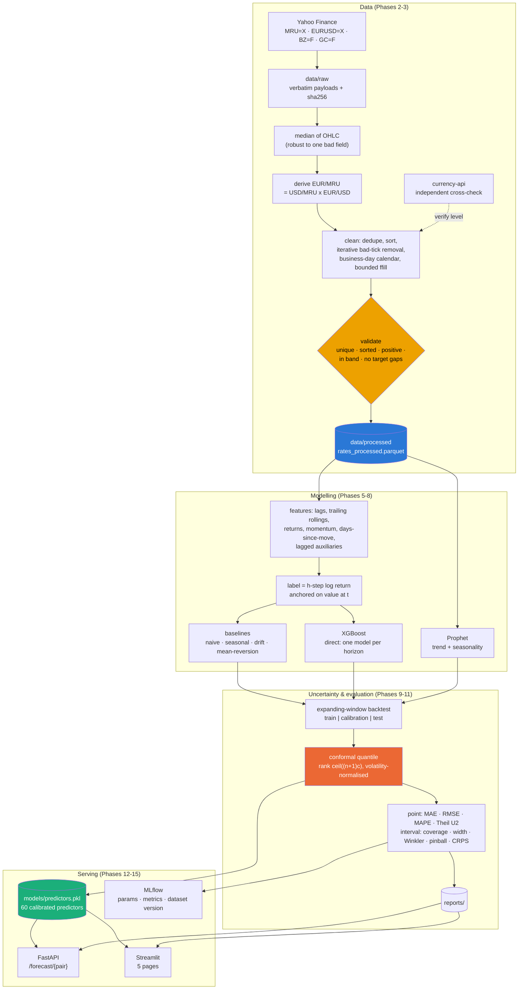

# MRU-Forecast

**Mauritanian Ouguiya exchange-rate forecasting with calibrated uncertainty.**

Forecasts USD/MRU and EUR/MRU at 1, 7 and 30 business days — and, more importantly,
says *how wrong it is likely to be*, using conformal prediction intervals whose
coverage is measured on a backtest rather than assumed.

```
USD/MRU — forecast made on 2026-09-14 (last observed: 40.030)

Date          Ahead   Prediction   Lower 90%   Upper 90%    Width
-----------------------------------------------------------------
2026-09-15        1      39.7330     39.4587     40.0073   0.5486
2026-09-16        2      39.7505     39.4721     40.0288   0.5567
2026-09-17        3      39.6361     39.3564     39.9158   0.5594
2026-09-18        4      39.6362     39.3277     39.9446   0.6169
2026-09-21        5      39.6132     39.3175     39.9089   0.5914
```

> ⚠️ **Experimental research project.** Rates are *indicative mid-market quotes* from a
> public market-data provider — **not** the official rate published by the Banque
> Centrale de Mauritanie. EUR/MRU is a **derived cross**, not an observed quote. Not
> investment advice. See [Limitations](#limitations).

---

## Table of contents

- [Problem statement](#problem-statement)
- [Business value](#business-value)
- [Why uncertainty is the point](#why-uncertainty-is-the-point)
- [Architecture](#architecture)
- [Dataset](#dataset)
- [Data pipeline](#data-pipeline)
- [Feature engineering](#feature-engineering)
- [Models](#models)
- [Conformal prediction](#conformal-prediction)
- [Backtesting](#backtesting)
- [Results](#results)
- [Calibration](#calibration)
- [Performance under market stress](#performance-under-market-stress)
- [Dashboard](#dashboard)
- [API](#api)
- [Installation](#installation)
- [Usage](#usage)
- [Docker](#docker)
- [Project structure](#project-structure)
- [Testing](#testing)
- [Limitations](#limitations)
- [Future improvements](#future-improvements)

---

## Problem statement

> *What will USD/MRU or EUR/MRU probably be over the next few days, and how uncertain
> is that?*

The second half of the question is the hard one, and the one most forecasting projects
skip. The Ouguiya is a **managed currency**: it does not move at all on ~30% of business
days, then steps by 1–3% about eight times a year. That combination makes a random walk
a genuinely strong benchmark and makes a bare point forecast close to useless on its own.

## Business value

An importer settling a USD invoice in 30 days does not need a number. They need a range
they can plan against. "40.20" is unusable; **"between 39.4 and 40.6 with 90% confidence,
and that range has actually contained the outcome 90% of the time in backtests"** is
something you can hedge, budget or negotiate against.

## Why uncertainty is the point

Financial series are close to unpredictable in the mean and very predictable in their
*variability*. This project takes that seriously:

| | Point forecast | Prediction interval |
|---|---|---|
| Can it beat a random walk here? | Sometimes, at short horizons | — |
| Is it verifiable? | Only in aggregate | **Yes — coverage is directly measurable** |
| Is it actionable? | Rarely alone | Yes |

The honest result below is that the point model beats a random walk on USD/MRU at 1 and
7 days, and **does not** at 30 days or on EUR/MRU at all. The intervals are well
calibrated at every horizon. That asymmetry is the finding, not a disappointment.

---

## Architecture



Clean separation is enforced by the package layout: `data` → `features` → `models` →
`evaluation` → `pipeline`, with `api/` and `dashboard/` as thin consumers that import the
library and never reimplement it.

---

## Dataset

| | |
|---|---|
| **Targets** | `USD_MRU` (MRU per 1 USD), `EUR_MRU` (MRU per 1 EUR) |
| **Auxiliary** | `EUR_USD`, `BRENT_OIL` (Brent futures), `GOLD` (gold futures) |
| **Frequency** | daily, business-day calendar |
| **Span** | 2018-11-01 → present (~2,050 business days) |
| **Rate type** | indicative mid-market provider quote — **not** the official BCM rate |
| **EUR/MRU** | **derived cross**, `USD/MRU × EUR/USD` — not an observed quote |
| **Source** | Yahoo Finance chart endpoint (no API key), cross-checked against currency-api |

Full provenance, the reasoning behind every choice, and the known limits are in
**[`docs/DATA_SOURCES.md`](docs/DATA_SOURCES.md)**.

### The raw feed is broken in a specific, fixable way

The provider emits isolated corrupted values — an observed `close` of **2.00 MRU/USD**
between two days at 36.2. Measured across the full history:

| Daily value taken as | std of daily % change |
|---|---|
| `close` | **43.2%** |
| `open` | 20.0% |
| **median of open/high/low/close** | **2.5%** |

A corrupted *single field* cannot move the median of four, so the daily value is that
median. `tests/test_data_sources.py` pins both the failure and the fix.

---

## Data pipeline

1. **Ingest** each series, archiving the raw payload verbatim with a SHA-256 so every
   later decision is auditable against the original bytes.
2. **Derive** EUR/MRU as a cross, labelled as derived everywhere downstream.
3. **Deduplicate** and sort chronologically.
4. **Flag bad ticks**, iteratively (see below).
5. **Mask** flagged points to `NaN` — never overwrite with an invented value.
6. **Project** onto a continuous business-day calendar.
7. **Forward-fill** closed days, bounded to 10 business days. *Forward only* —
   backward filling would place a future observation in the past.
8. **Validate**: unique, sorted, positive, inside a plausible band, no gaps in a target.
9. **Persist** the dataset, the flag log and a JSON report.

### Bad ticks vs real policy steps

This distinction is the heart of the cleaning, because a managed currency's *real* moves
look superficially like the corrupted ones:

| | deviates from previous | deviates from next |
|---|---|---|
| **bad tick** | yes | **yes, same direction** |
| **step devaluation** | yes | no — the new level persists |

`detect_isolated_spikes` encodes exactly that asymmetry, and runs **iteratively**: a
corrupted *run* hides its members from a single pass, because each bad point's neighbour
is itself bad (December 2022 in the live feed is precisely that case).

| USD/MRU | raw | cleaned |
|---|---|---|
| days moving more than 5% | 11 | **0** |
| largest daily move | 81.5% | 3.6% |
| minimum value | 2.00 | 33.90 |

Brent and gold keep their genuine 20%+ COVID-crash moves. Nothing real is deleted.

---

## Feature engineering

69 features, all computable at time *t* from information available at *t*:

- **calendar** — day of week, month, quarter, month/quarter-end, with sin/cos encoding
  so December and January are one step apart rather than eleven;
- **lags** — 1, 2, 3, 5, 7, 10, 14, 21, 30;
- **trailing rollings** — mean, std, min, max over 7/14/30, plus distance from the local
  mean (scale-free, so it survives a change in the level of the series);
- **returns** — 1-day and multi-day log returns, realised volatility;
- **`days_since_move`** — how long the rate has sat perfectly still. On a managed
  currency this is the single most informative state variable and no plain lag can see it;
- **momentum and range position** over 7/30;
- **auxiliary series**, lagged by at least one day — a same-day quote from another
  market is only safe if it closes first, and that cannot be verified from the data.

### Leakage prevention

Three mechanisms, all tested rather than asserted:

1. Rolling windows are **trailing**, never `center=True`.
2. The label is shifted **backwards** (`y_t = f(value_{t+h})`); features are never
   shifted forwards.
3. `tests/test_features.py` recomputes every feature on a **truncated history** and
   requires the shared rows to be identical. Any feature that peeks forward changes, and
   the test fails.

### Why the label is a return, not a level

Gradient-boosted trees predict a constant within each leaf, so they **cannot produce a
value outside the range they were trained on**. A rate that drifted from 35.75 to 40.03
would be structurally capped at 40.03 by a level model. The label is therefore the
*h*-step log return, anchored on the last observed value:

```
y_t = log(value_{t+h}) − log(value_t)
prediction_{t+h} = value_t · exp(ŷ_t)
```

---

## Models

| Model | What it is | Why it is here |
|---|---|---|
| **Naive** | `pred(t+h) = value(t)` | The benchmark the FX literature has repeatedly found hard to beat |
| **Seasonal naive** | last week's value at the same weekday | Tests whether any weekly structure exists — the EDA says no, and this is how that is *checked* |
| **Drift** | random walk with a trailing drift estimate | Captures the slow crawl of a managed peg |
| **Mean reversion** | `pred = value + κ·(mean_w − value)`, κ fitted | The EDA found ACF(1) ≈ −0.30; that deserves a baseline that exploits it *directly*, before claiming a boosted model was needed |
| **XGBoost** | direct strategy, one model per horizon | The main model |
| **Prophet** | additive trend + seasonality | The standard "is there trend/seasonality worth modelling?" check |

### Direct, not recursive

One model per horizon maps features at *t* straight to the outcome at *t + h*. The
recursive alternative feeds a one-step model its own output, and by *h* = 30 the
compounded error dominates. Direct costs one model per horizon and buys an error that
does not compound. Serving a *daily path* out to 30 days therefore means 30 models per
pair — 60 in total, about 90 s to train.

---

## Conformal prediction

Split (inductive) conformal prediction turns any point forecaster into an interval
forecaster with a finite-sample guarantee, assuming nothing about the error distribution.

```
Training set     ──▶  fit the point model
Calibration set  ──▶  scores  s_i = |y_i − ŷ_i| / scale_i
                 ──▶  conformal quantile q = ceil((n+1)·c)-th smallest score
New forecast     ──▶  interval  [ŷ − q·scale,  ŷ + q·scale]
```

```python
predictor = ConformalPredictor(XGBoostForecaster(), confidence_levels=[0.80, 0.90, 0.95])
predictor.fit(frame, "USD_MRU", horizon=7, config=config, train_end=train_end)
predictor.calibrate(frame, calibration_origins)
predictor.predict_interval(frame, test_origins)
```

Four details that are easy to get wrong and are handled explicitly:

1. **The `n+1` in the rank is not cosmetic.** The plain empirical quantile under-covers;
   the corrected rank is what makes `P(y ∈ interval) ≥ 1 − α` hold in finite samples.
2. **A calibration set too small to certify a level says so.** Requesting 95% coverage
   from 10 scores returns `+inf` — an honest "cannot certify this" rather than a
   quietly-wrong maximum.
3. **Scores are normalised by trailing volatility**, so the interval *breathes* with the
   market instead of averaging calm and storm into one width.
4. **Exchangeability is violated by time series, and that is stated.** Two mitigations
   ship — volatility normalisation, and an `AdaptiveConformalPredictor` implementing
   Adaptive Conformal Inference (Gibbs & Candès, 2021), which updates the working
   miscoverage rate online. The residual gap is then *measured*, in
   [Calibration](#calibration).

---

## Backtesting

No `train_test_split`: shuffling would train on 2026 and test on 2020. Every split is
strictly chronological, with three blocks in time order.

```
split 0   |........ train ........|.. calibration ..|.. test ..|
split 1   |.......... train ..........|.. calibration ..|.. test ..|
split 2   |............ train ............|.. calibration ..|.. test ..|
```

| Setting | Value |
|---|---|
| Scheme | expanding window |
| Splits | 12 |
| Train | 1,521 → 1,752 business days (grows) |
| Calibration | 250 business days (held out, never fitted on) |
| Test | 21 business days per split |
| Step | 21 business days |
| Out-of-sample period | **2025-08-15 → 2026-09-14** (252 origins, 9,072 predictions) |

Two design decisions worth naming:

- Splits are anchored at the **end** of the sample and stepped backwards, so the
  evaluation always covers the most recent period rather than an arbitrary early window.
- The grid is shifted back by `max(horizon)`, so **every test origin has a realised
  outcome** — a 30-day forecast made at the last test origin can still be scored.

---

## Results

Out-of-sample, USD/MRU, 252 origins per cell. **Theil's U2** is the model's RMSE divided
by the random walk's: below 1 beats a random walk, at or above 1 does not.

| h | Model | MAE | RMSE | **Theil U2** | Direction % |
|---|---|---|---|---|---|
| 1 | **xgboost** | **0.1397** | **0.1970** | **0.854** | 71.9 |
| 1 | mean_reversion | 0.1531 | 0.2234 | 0.969 | 74.7 |
| 1 | naive | 0.1572 | 0.2307 | 1.000 | — |
| 1 | prophet | 0.2772 | 0.3725 | 1.615 | 61.5 |
| 7 | **xgboost** | **0.1716** | **0.2291** | **0.876** | 65.9 |
| 7 | naive | 0.1890 | 0.2614 | 1.000 | — |
| 7 | prophet | 0.3401 | 0.4542 | 1.737 | 61.5 |
| 30 | **naive** | **0.2056** | **0.2756** | **1.000** | — |
| 30 | xgboost | 0.2390 | 0.3067 | 1.113 | 60.7 |
| 30 | prophet | 0.4994 | 0.6209 | 2.253 | 57.1 |

**What this says, plainly:**

- XGBoost beats the random walk at **1 day (−14.6% RMSE)** and **7 days (−12.4% RMSE)**.
- At **30 days it loses**, and the random walk wins. Reported, not buried.
- On **EUR/MRU it never wins** (U2 = 1.005 / 1.097 / 1.424). The derived cross inherits
  EUR/USD, a deep and efficient market with no comparable mean-reversion to exploit.
- **Prophet is clearly the worst model here** — there is no trend or seasonality of the
  kind it is built for. A negative result, and a useful one.
- `Direction %` is blank for naive on purpose: predicting no change expresses no
  direction, so there is nothing to score. Reporting 0% would be misleading.

The best cell is **USD/MRU at h=1**, where XGBoost + conformal is better on *both* axes
at once — more accurate **and** a narrower interval at the same coverage:

| Model | MAE | 90% coverage | Mean width | **Winkler** |
|---|---|---|---|---|
| **xgboost + conformal** | **0.1397** | 89.3% | **0.694** | **0.961** |
| naive + conformal | 0.1572 | 89.7% | 0.806 | 1.158 |
| prophet + conformal | 0.2772 | 88.9% | 1.798 | 2.423 |

---

## Calibration

Pooled over both pairs and all three horizons, n = 1,512 per row.

| Model | Nominal | **Empirical** | Error (pp) | s.e. (pp) | Mean width |
|---|---|---|---|---|---|
| naive | 80% | **80.3%** | +0.29 | 1.02 | 1.179 |
| naive | 90% | **89.8%** | −0.19 | 0.78 | 1.557 |
| naive | 95% | **94.4%** | −0.56 | 0.59 | 1.980 |
| xgboost | 80% | 83.2% | +3.20 | 0.96 | 1.481 |
| xgboost | 90% | **92.1%** | +2.06 | 0.70 | 1.921 |
| xgboost | 95% | **96.0%** | +1.03 | 0.50 | 2.300 |
| prophet | 80% | 85.3% | +5.32 | 0.91 | 3.120 |

Every model lands within ~3pp of its nominal level across all three levels. XGBoost runs
slightly **conservative** (over-covers), which is the safe direction to err.

**Read the s.e. column before the error column.** Coverage on a finite sample is an
estimate: a gap smaller than roughly twice its standard error is indistinguishable from
sampling noise. This is why `coverage_se_pp` sits next to every coverage figure in the
tables, the API and the dashboard.

---

## Performance under market stress

Origins are grouped by the **trailing** 30-day realised volatility in force on that date
— trailing, so a date's regime is knowable on that date and the metric is not
contaminated by the future.

USD/MRU at h = 1, 90% intervals:

| Model | Regime | n | MAE | Coverage | Mean width |
|---|---|---|---|---|---|
| naive | normal | 72 | 0.126 | 86.1% | 0.493 |
| naive | **high** | 180 | 0.170 | **91.1%** | **0.931** |
| xgboost | normal | 72 | 0.109 | 83.3% | 0.424 |
| xgboost | **high** | 180 | 0.152 | **91.7%** | **0.802** |

This is the payoff of volatility-normalised scores. Going from normal to high volatility,
the interval **widens by ~90%** and coverage *holds* — it even improves. A non-adaptive
interval would keep its width and lose coverage exactly when it matters most.

So: **yes, the model stays reliable when the market gets turbulent** — by being honest
about needing a wider range, not by pretending the uncertainty went away.

---

## Dashboard

```bash
make dashboard      # http://localhost:8501
```

| Page | What it shows |
|---|---|
| **Overview** | current rates, forecast at a chosen horizon, headline backtest metrics |
| **USD/MRU** | history + forecast + nested 80/90/95% bands, volatility, feature importance |
| **EUR/MRU** | the same, labelled as a derived cross |
| **Model comparison** | every model on the same splits, plus performance by volatility regime |
| **Uncertainty** | calibration curve, width vs level, rolling coverage over time |

Charts follow one system throughout: a CVD-validated categorical palette (adjacent-pair
ΔE ≥ 8 in both light and dark), a single y-axis per figure — never a dual axis — and a
readable table beside every chart whose colours sit below 3:1 contrast on a light surface.

## API

```bash
make api            # http://localhost:8000/docs
```

| Endpoint | Purpose |
|---|---|
| `GET /health` | liveness + readiness; reports `degraded` with a reason when artefacts are missing |
| `GET /rates/latest` | most recent observed rate for both pairs |
| `GET /rates/{pair}/history?days=365` | observed history |
| `GET /forecast/{pair}?horizon=7&confidence=0.90` | forecast path with intervals |
| `GET /models/performance` | backtested accuracy per model and horizon |
| `GET /models/calibration` | nominal vs empirical coverage |

```bash
curl "http://localhost:8000/forecast/usd-mru?horizon=7&confidence=0.90"
```

```json
{
  "currency_pair": "USD/MRU",
  "rate_definition": "MRU per 1 USD",
  "rate_type": "indicative_mid_market",
  "is_derived_cross": false,
  "horizon": 7,
  "confidence": 0.9,
  "anchor_date": "2026-09-14",
  "anchor_value": 40.029999,
  "model": "xgboost",
  "forecast": [
    {
      "date": "2026-09-15",
      "days_ahead": 1,
      "prediction": 39.733001,
      "lower": 39.458688,
      "upper": 40.007314,
      "interval_width": 0.548626
    }
  ],
  "disclaimer": "Experimental forecast built on indicative mid-market rates ..."
}
```

Every response carries its provenance — rate type, whether the pair is derived, and the
disclaimer — because a number without those is not interpretable.

---

## Installation

Ubuntu / Debian, Python 3.11 or 3.12:

```bash
sudo apt update && sudo apt install -y python3.12 python3.12-venv build-essential

git clone <repository-url> mru-forecast
cd mru-forecast

make setup          # venv + editable install + .env from the template
source .venv/bin/activate
make check          # verify the environment
```

No API key is required: every data source used works unauthenticated. `.env.example`
documents optional keys for providers that are *not* needed for the default pipeline.

## Usage

```bash
python scripts/download_data.py    # fetch + archive raw payloads       (~15 s)
python scripts/build_dataset.py    # clean + validate                    (~2 s)
python scripts/run_eda.py          # analysis + 10 Plotly figures        (~10 s)
python scripts/train.py            # 60 calibrated predictors            (~90 s)
python scripts/predict.py --target USD_MRU --horizon 7
python scripts/backtest.py         # full backtest, all models           (~15 min)
python scripts/backtest.py --no-prophet   # fast variant                 (~1 min)
```

Everything is also available through `make`:

```bash
make help
```

Notebooks (`make notebook`) call the same library functions the scripts do, so an
analysis can never drift from what the pipeline actually runs:

| Notebook | Topic |
|---|---|
| `01_data_exploration.ipynb` | provenance, raw vs cleaned, cross-check |
| `02_data_analysis.ipynb` | stationarity, volatility, ACF, seasonality, correlation |
| `03_baseline_models.ipynb` | backtest design, leakage check, model comparison |
| `04_model_evaluation.ipynb` | conformal mechanics, calibration, volatility regimes |

## Docker

```bash
cp .env.example .env
docker compose up --build       # first run: ~5 min (image build + full pipeline)
```

Verified end to end inside the container: 60 predictors trained, `GET /health` returns
`models_loaded: true` with real forecasts, and **all five dashboard pages render with
their charts and tables** — checked by executing the app in the container, not by
trusting the healthcheck (Streamlit answers `/_stcore/health` even when the page itself
is crashing).

- `trainer` runs once — download → clean → train → fast backtest — and exits;
- `api` and `dashboard` wait for its artefacts, then serve on **8000** and **8501**.

The fast backtest (no Prophet, ~70 s) is part of the trainer because the
**Model comparison** and **Uncertainty** pages read its reports — without them two of
the dashboard's five pages come up empty. `SKIP_BACKTEST=1` opts out.

The three share one image and one set of named volumes, so the models trained once are
the models served. The trainer is **idempotent**: a second `docker compose up` sees the
existing artefacts and skips straight to serving (~1.5 s instead of ~3 min). Force a
rebuild when the data has moved on:

```bash
FORCE_RETRAIN=1 docker compose up trainer
```

Optional services sit behind profiles:

```bash
docker compose --profile mlflow up          # + MLflow UI on 5000
docker compose --profile postgres up        # + PostgreSQL
docker compose --profile backtest run backtest   # the full backtest, Prophet included
```

## MLflow

`scripts/train.py` logs each run: model parameters, backtest metrics per
(target, horizon, model), artefacts, and the **dataset version** as tags (first date,
last date, observation count) — so a metric can always be traced to the data that
produced it.

```bash
make mlflow         # http://localhost:5000
```

---

## Project structure

```
mru-forecast/
├── api/                        FastAPI service
│   ├── main.py                 routes
│   ├── schemas.py              typed responses (OpenAPI contract)
│   └── service.py              cached loaders + business logic
├── configs/config.yaml         single source of truth for every parameter
├── dashboard/                  Streamlit app (5 pages)
├── data/
│   ├── raw/                    verbatim provider payloads + checksums
│   ├── interim/                tidy, uncleaned + ingestion manifest
│   └── processed/              modelling dataset + cleaning flags + report
├── docs/
│   ├── DATA_SOURCES.md         provenance, rate types, known limits
│   └── figures/                exported Plotly figures
├── notebooks/                  4 executed analysis notebooks
├── reports/                    backtest predictions + all metric tables
├── scripts/
│   ├── download_data.py        Phase 2
│   ├── build_dataset.py        Phase 3
│   ├── run_eda.py              Phase 4
│   ├── train.py                Phases 10 & 14
│   ├── backtest.py             Phases 9 & 11
│   ├── predict.py              serving from the CLI
│   └── make_notebooks.py       regenerates the notebooks
├── src/mru_forecast/
│   ├── config.py               YAML + .env, with ${VAR} expansion
│   ├── viz.py                  every chart in the project
│   ├── data/                   sources · ingestion · cleaning · validation
│   ├── features/engineering.py leakage-checked feature construction
│   ├── models/                 base · baseline · xgboost · prophet · conformal
│   ├── evaluation/             eda · metrics · uncertainty · backtesting
│   └── pipeline/               end-to-end training, persistence, MLflow
├── tests/                      324 tests
├── Dockerfile                  multi-stage; one image, three entry points
└── docker-compose.yml          trainer → api + dashboard (+ optional profiles)
```

## Testing

```bash
make test           # 324 tests
make test-fast      # skips slow + network tests
make lint           # ruff
```

| Suite | Focus |
|---|---|
| `test_cleaning.py` | bad ticks removed, **real policy steps kept**, ffill never looks backwards |
| `test_features.py` | **no leakage** — every feature recomputed on a truncated history must be identical |
| `test_models.py` | the origin protocol: tampering with data *after* an origin must not move a forecast |
| `test_conformal.py` | the `ceil((n+1)c)` rank, coverage on exchangeable and heavy-tailed data, cross-checked against MAPIE |
| `test_metrics.py` | proper scoring rules are minimised by the truth (verified, not assumed) |
| `test_api.py` | `lower ≤ prediction ≤ upper`, nested levels, error codes |
| `test_dashboard.py` | every page renders without raising, and states the disclaimer |
| `test_viz.py` | no dual-axis chart, legend rules, palette stability |

Tests that need the built artefacts **skip** rather than fail, so the suite is meaningful
on a fresh clone and thorough on a built one.

---

## Limitations

Stated up front, because a forecasting project that hides these is not credible.

1. **Not the official rate.** These are indicative mid-market provider quotes. The BCM
   publishes the official rate; it has no stable machine-readable history to ingest
   reproducibly, so it is not used. The two can differ.
2. **Provider disagreement sets a floor on what "accurate" can mean.** Two independent
   sources differ on USD/MRU by 0.2–3.0%, *systematically*. A MAE of 0.14 MRU (≈0.35%)
   is well inside that disagreement. The model is not more accurate than the data.
3. **EUR/MRU is a derived cross**, so it carries the noise of two legs. That is visible
   in the results: no model beats a random walk on it at any horizon.
4. **Forward-filling induces autocorrelation.** Part of the observed ACF(1) ≈ −0.30 is
   measurement artefact, not economics — which is why model value is judged on a
   backtest, never on that statistic.
5. **Conformal coverage assumes exchangeability**, which time series violate. Two
   mitigations ship and the residual gap is measured (2–3pp) rather than assumed away.
6. **~2,050 business days of history.** Enough for this backtest; short enough that one
   regime change is a large fraction of the sample.
7. **A managed currency can be re-pegged by policy.** No model trained on past behaviour
   can anticipate an administrative decision, and the prediction intervals do not cover
   that risk.
8. **Backtest results are historical.** They describe how the intervals behaved on
   2025-08 → 2026-09. They are evidence, not a guarantee about the future.

## Future improvements

- **Ingest the official BCM rate** and model the spread against the market rate — the
  single change that would most improve the project's relevance.
- **Serve Adaptive Conformal Inference.** It is implemented and evaluated but not
  served; online α updates would help most exactly where static conformal is weakest.
- **Add macro regressors** (Mauritanian CPI, iron-ore prices, FX reserves) at their real
  publication lag, which requires a point-in-time store to avoid look-ahead bias.
- **Quantile regression as a second interval method**, to compare against conformal on
  the same splits rather than assuming conformal is best.
- **Nightly scheduled retraining** with data-drift monitoring and alerting on coverage
  degradation.
- **Register models in MLflow Model Registry** with a promotion gate on backtested
  coverage.

---

## License

MIT — see [LICENSE](LICENSE).

**Disclaimer.** This is an experimental research project. It uses indicative market data,
not official central-bank rates, and its forecasts must not be used as a basis for
financial decisions.
